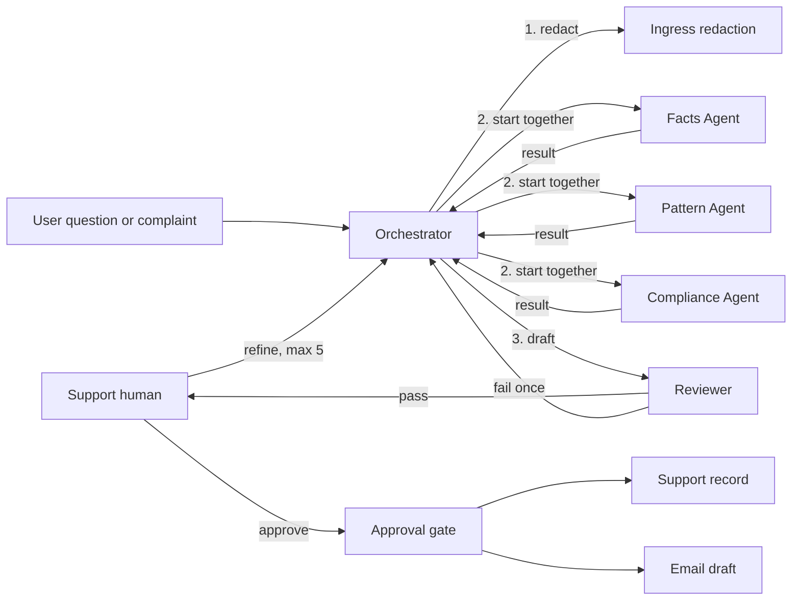
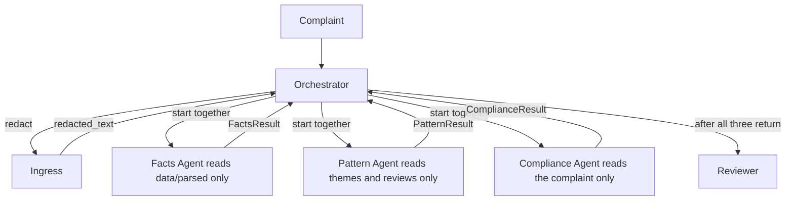
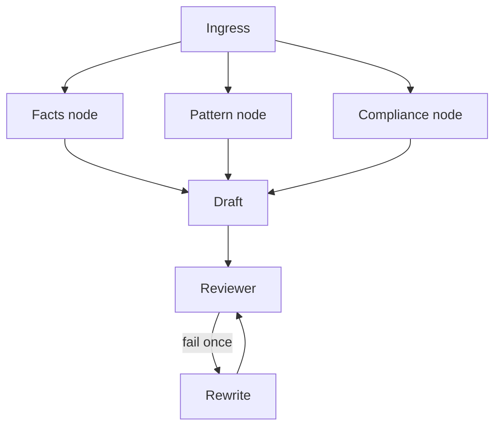
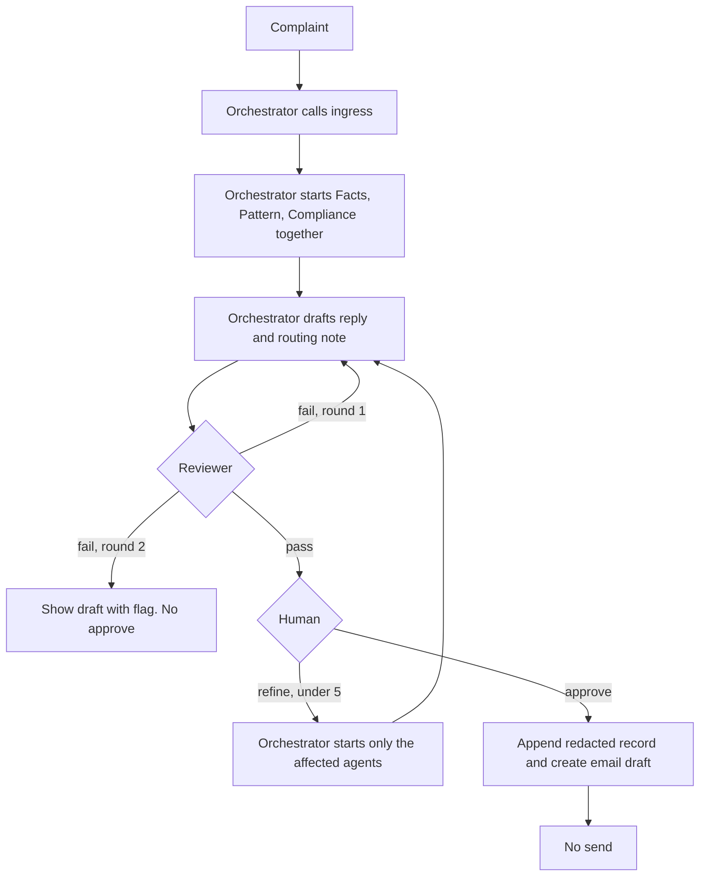
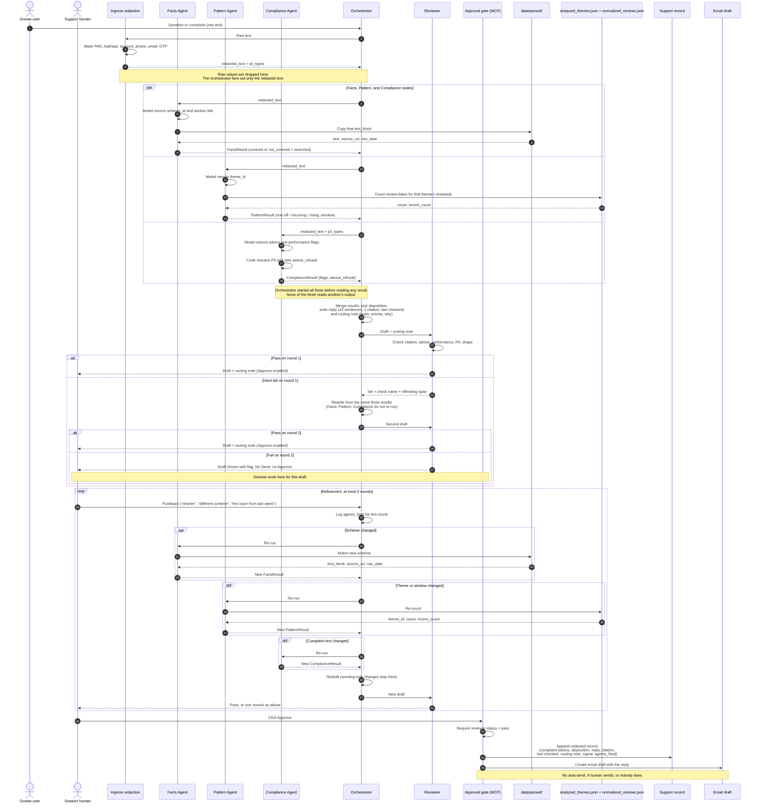

# Architecture: Groww Multi-Agent Support Reply System

This document turns `docs/problemStatement.md` into a buildable design. It names each component, what it may read, the structured outputs it must return, and how a complaint moves from input to an approval-gated email draft.

The system drafts a support reply for a Groww user question. It does not send email, give investment advice, or answer from anything outside `data/`.

## Constraints that shape the design

These rules come from the problem statement and decide the shape below.

1. The **orchestrator** starts Facts, Pattern, and Compliance **at the same time**. None waits on another, and none reads another's output. The orchestrator does not pass one result into the next call.
2. The orchestrator is the only component that reads all three outputs. It calls the **reviewer** only after the merge.
3. The Compliance Agent must scan the **incoming** message during that parallel step. The outgoing draft does not exist yet, so the **reviewer** applies the same compliance policy to the draft after the orchestrator writes it.
4. **No PII** is stored in logs, agent state, the approval record, or the email draft. The orchestrator calls a deterministic ingress step and fans out only the redacted text, so agent inputs and state never hold a raw PAN, Aadhaar, account number, phone, email, or OTP.
5. Facts come only from `data/parsed/`. No match means `"not covered"`, not a guess.
6. A reply is at most **three sentences**, facts-only, with one citation link and a last-checked date. No citation means it does not ship.
7. Reviewer rework is **one round**. Human refinement is **five rounds**. After a second reviewer failure, the draft is shown with the flag and **Send is not offered**.
8. Nothing is appended or emailed until a human clicks **approve**. There is no auto-send.

## System context



| Store | Role | Who reads it |
|---|---|---|
| `data/parsed/*.json` plus `parse_manifest.json` | Milestone 1 corpus. Five HDFC schemes, seven sections each. `source_url` is the only legal citation. | Facts Agent |
| `data/analyzed_themes.json` | Milestone 2 themes: `allThemes` and `topThemes`. | Pattern Agent |
| `data/normalized_reviews.json` | 1,650 reviews, 2026-04-12 to 2026-07-04. Used to count a theme inside a time slice. | Pattern Agent |
| Session state | Redacted message, agent outputs, draft, reviewer flags, agents fired, refinement count. | Orchestrator, reviewer, approval gate |
| Support record and email draft | Written only after approval. | Approval gate |

Agents do not scrape Groww or fetch new scheme pages. The model inside a node may return an id from that node's allowed list. The fact text, the citation, the count, and the signal come from the files above.

## Parallel fan-out

The orchestrator is the only caller. It redacts first, starts the three agents together, waits until all three have returned, merges, then sends the draft to the reviewer. The same caller handles the first pass and every refinement, so there is one place that decides who runs.

Ingress is not a dispatcher. It is a function the orchestrator calls, and it returns `redacted_text` plus `pii_types`. That string, and nothing else, is what the orchestrator hands to each agent. An agent never receives another agent's result.



The orchestrator must issue the three starts before it reads any result. Reading Facts before starting Pattern would break the parallel rule. It is the first component allowed to see `FactsResult`, `PatternResult`, and `ComplianceResult` together, and the reviewer is the next step only after that merge.

## LangGraph

The orchestrator is one LangGraph `StateGraph`. Facts, Pattern, and Compliance are nodes of that graph. Ingress, the draft, and the reviewer are nodes too. The three agent nodes are the ones that call a model.

Graph state holds `redacted_text`, `pii_types`, and the three result channels. An agent node reads `redacted_text`. Compliance also reads `pii_types`. The node writes only its own channel.



Each agent node is itself a small graph. Its first step calls the model. The later steps are code, and those steps are what the JSON contracts check.

| Node | Model returns | Code then does |
|---|---|---|
| Facts | One `scheme_id` and one section title, or neither | Copies `fact` from that `text_block`, sets `citation` to that file's `source_url`, and sets `last_checked` to `nav_date`. A missing match returns `not_covered`. |
| Pattern | One `theme_id` from `allThemes` | Counts that theme's review dates and sets `one-off`, `rising`, or `recurring`. |
| Compliance | `advice`, `performance_claim`, or neither | Rescans for PII, merges `pii_types`, and sets `advice_refusal` when either model flag is present. |

The model sees the redacted complaint and the allowed ids for its node. It does not see another agent's result or the draft.

The configured model is Groq (`GROQ_API_KEY`, optional `GROQ_MODEL`). With no key, or when the Groq call fails, the same node runs the cue tables and returns the same contract. The acceptance run uses that path and does not open a network connection.

A reviewer failure follows the rewrite edge. That edge does not re-enter Facts, Pattern, or Compliance. A human refinement re-enters only the node the pushback names.

## Walkthrough: exit load on HDFC Large Cap

Complaint: *"Why was I charged an exit load on HDFC Large Cap Fund?"*

1. The **orchestrator** receives the complaint and calls ingress. Ingress finds no PII.
2. The graph starts the **Facts**, **Pattern**, and **Compliance** nodes together, each with the same redacted text. The Facts model returns `large_cap` and `Exit load`. Code copies *"Exit load of 1% if redeemed within 1 year"* with `https://groww.in/mutual-funds/hdfc-large-cap-fund-direct-growth` and last-checked `25-Jun-2026`. The Pattern model returns `fees_brokerage`. Code counts 136 reviews (avg rating 2.2) over 2026-04-12 to 2026-07-04 and labels the signal recurring or rising from the date split below. The Compliance model returns no advice and no performance flag, and the PII scan is empty. All three results come back on the graph state.
3. The **orchestrator** writes at most three sentences stating the cited exit-load rule and the last-checked date, plus a routing note to the fees team. If the pattern signal is recurring or rising, the note says the ticket stays open because the same issue is already showing up across reviews. It does not close the ticket just because the fact was easy.
4. The orchestrator **sends that draft to the reviewer**. The reviewer checks citation, advice, PII, and length. On pass, the human sees the draft and the routing note.
5. **Approve** appends a redacted record and creates an email draft. Nothing is sent.

## Components

### Ingress redaction

Deterministic, not an LLM agent. The orchestrator calls it once, before fan-out, and fans out only what it returns.

It masks:

| Class | Examples |
|---|---|
| PAN | `ABCDE1234F` |
| Aadhaar | 12 digits, with or without spaces |
| Account numbers | long digit runs in an account context |
| Phone | Indian mobile numbers |
| Email | standard email addresses |
| OTP | 4–8 digit codes labeled as OTP or one-time password |

Each match is replaced with a typed token such as `[PAN]`, `[PHONE]`, `[EMAIL]`. The raw value is dropped. It is not written to logs or session state.

Ingress also returns the list of token types found (`pii_types`), with no raw values. The Compliance Agent and the reviewer both see that list.

### Facts Agent

**Reads:** the redacted complaint and `data/parsed/` only.

**Model:** one call. It returns at most one of the five `scheme_id` values and one of the seven section titles. An id outside those lists is no match.

**Code:** load the chosen section and copy it. The model does not write `fact`, `citation`, or `last_checked`.

| `scheme_id` | Name cues | Exit load in corpus |
|---|---|---|
| `large_cap` | HDFC Large Cap | 1% if redeemed within 1 year |
| `mid_cap` | HDFC Mid Cap | 1% if redeemed within 1 year |
| `small_cap` | HDFC Small Cap | 1% if redeemed within 1 year |
| `gold_fof` | HDFC Gold ETF Fund of Fund | 1% if redeemed within 15 days |
| `silver_fof` | HDFC Silver ETF FoF | 1% if redeemed within 15 days |

Sections available in every file: Key fund facts, Exit load, Benchmark, Investment objective, Stamp duty and tax, Fund management, Minimum investments.

**Covered** means the scheme is one of the five **and** a section states the fact. The answer text is taken from that `text_block`. The citation is that file's `source_url`. Exactly one link. `last_checked` is the file's `nav_date` (`25-Jun-2026`).

**Not covered** means a different scheme, a different AMC, an app bug, an order, a withdrawal, a login failure, or any question the seven sections do not answer. The agent returns `status: "not_covered"` and lists the schemes and section titles it searched. It does not fill the gap from general knowledge, and it does not cite a URL that is not one of the five `source_url`s.

NAV, expense ratio, exit load, stamp duty, and the tax rule in the corpus are citable facts. A past or expected **return**, a performance comparison, or a rating of the scheme is not an answer this agent may add, even if a model "knows" it. Those sentences are absent from the corpus on purpose.

### Pattern Agent

**Reads:** the redacted complaint, `data/analyzed_themes.json`, and review `date`s from `data/normalized_reviews.json` for the matched theme's `reviewIds`.

**Model:** one call. It returns one `theme_id` from `allThemes`, not only `topThemes`. An exit-load or brokerage complaint maps to `fees_brokerage` even though that theme is outside `topThemes`. An unknown id is `other`.

**Code:** load that theme, count its review dates, and set the signal. The model does not write `count`, `recent_count`, or `signal`.

| `id` | Name | Count | Avg rating | In `topThemes` |
|---|---|---:|---:|---|
| `other` | Other feedback | 709 | 3.5 | no |
| `trading_charts` | Trading, charts & orders | 503 | 2.7 | yes |
| `money_movement` | Withdrawals, deposits & payments | 162 | 2.5 | yes |
| `reliability` | App stability & performance | 140 | 2.2 | yes |
| `fees_brokerage` | Fees & brokerage | 136 | 2.2 | no |

The published theme file has one window and no trend field. The agent derives the signal by splitting review dates:

- **Window:** 2026-04-12 through 2026-07-04 (the full review file).
- **Recent slice:** the last 7 days of that window, 2026-06-28 through 2026-07-04.
- **Earlier slice:** 2026-04-12 through 2026-06-27.

| Signal | Rule |
|---|---|
| `one-off` | Theme is `other`, or the matched theme has fewer than 20 reviews in the full window. |
| `rising` | Theme is not `other`, full-window count is at least 20, and the recent 7-day count is at least 40 **or** at least 2× the weekly rate of the earlier slice. |
| `recurring` | Theme is not `other`, full-window count is at least 20, and the recent slice does not meet the rising test. |

`fees_brokerage` (136), `money_movement` (162), `reliability` (140), and `trading_charts` (503) all clear the recurring bar unless the recent slice makes them rising. The "forty people this week" case in the problem statement is the rising bar of 40 in the recent slice.

The agent returns the theme `id`, `count` (full window), `recent_count`, `signal`, and the window dates. It does not read Facts or Compliance output.

### Compliance Agent

**Reads:** the redacted complaint and the ingress `pii_types` list. It does not read the other agents and it does not see the draft.

**Model:** one call on the redacted complaint. It returns `advice`, `performance_claim`, or neither. It does not redact, and it does not receive a raw PAN, Aadhaar, account number, phone, email, or OTP.

**Code:** rescan the redacted text for PII ingress missed, merge `pii_types`, and set `advice_refusal` when `advice` or `performance_claim` is present.

**Flags on the input:**

| Flag | What trips it |
|---|---|
| `advice` | Redeem or not, buy, sell, hold, "is this scheme good", "should I stay invested", "what returns should I expect". |
| `performance_claim` | The user asks for a return, CAGR, or performance figure, or the message already asserts one that a reply might repeat. |
| `pii` | Ingress reported any PII type, or the agent still sees a PAN, Aadhaar, account number, phone, email, or OTP that ingress missed. |

Advice and performance questions are **refusals for the whole session**, including rephrases later in that session. A later "ok but just tell me if large cap is worth it" stays a refusal. The orchestrator may still attach a cited corpus fact only when the fact does not answer the advice question. "Should I redeem?" is a refusal, not an exit-load recommendation.

PII in the output of this agent is types and tokens only (`[PAN]`), never the original value.

### Orchestrator

The orchestrator is the controller for a complaint thread.

1. Call ingress on the raw complaint.
2. Start Facts, Pattern, and Compliance together with `redacted_text`. Do not start the next agent only after the previous one returns.
3. Collect `FactsResult`, `PatternResult`, and `ComplianceResult`.
4. Write the reply draft and the routing note.
5. Send that pair to the reviewer.

On a reviewer failure it rewrites from the three results it already holds. It does not start the agents again for that failure. On a human refinement it starts only the agents that pushback names, then sends the new draft to the reviewer.

**Reads:** the three structured results and the redacted complaint. It does not open the corpus or the theme file itself. If a fact is missing, it stays missing.

**Writes two artifacts:**

1. **Reply draft.** At most three sentences. Facts only. Includes the single `source_url` when `FactsResult.status` is `covered`, and the `last_checked` date. When status is `not_covered`, the draft says the corpus does not cover it and names what was searched. It does not invent a fact to sound complete.
2. **Routing note.** Team, priority, and why. The why cites the pattern signal, the theme id, and the count. This note is internal. It is not pasted into the user-facing reply.

**Disposition** (how the ticket is treated, separate from the wording of the draft):

| Situation | Disposition |
|---|---|
| Facts covered, pattern `one-off`, compliance clean | `reply`. A human may approve. |
| Facts covered, pattern `recurring` or `rising` | `escalate`. The draft can still state the cited fact. The routing note says the ticket stays open because the pattern is broader than this one user. Do not close it. |
| Facts `not_covered` | `handoff`. No citation, no invented answer. Route to a human queue. |
| Compliance `advice` or `performance_claim` | `refuse`. Refusal text only. Do not answer "should I redeem", "is it good", or "what returns". |
| Facts covered and pattern is a surge on the same issue | `disagree`. Say both things: the corpus has an answer, and N reviews in the recent window match this theme. Do not send-and-close. |

The disagree case is the problem statement's example: a clean exit-load fact plus forty people asking the same thing this week. Both belong in the routing note. Priority follows the pattern signal, not whichever agent finished last.

**Team map** (routing note, not the user reply):

| Theme | Team |
|---|---|
| `fees_brokerage` | Fees and mutual fund ops |
| `money_movement` | Payments |
| `trading_charts` | Trading platform |
| `reliability` | App stability |
| `other` | General support |
| Scheme fact with no theme surge | Mutual fund support, using the matched `scheme_id` |

**Priority from the pattern signal:**

| Signal | Priority |
|---|---|
| `rising` | P1 |
| `recurring` | P2 |
| `one-off` | P3 |
| `disagree` or `escalate` | At least P2, P1 when the signal is `rising` |

Sentence budget: three sentences for the user-facing draft. The routing note is separate and does not count toward the three.

### Reviewer

The reviewer is the outgoing scan. It is not a fourth parallel agent. The orchestrator calls it only after the merge. The reviewer returns pass or fail to the orchestrator. It never starts Facts, Pattern, or Compliance itself.

**Hard fails:**

| Check | Fail when |
|---|---|
| Citation | A factual claim has no `source_url`, more than one link, or a link that is not the `source_url` for the scheme Facts returned. `not_covered` drafts must not contain a factual claim at all. |
| Advice | Buy, sell, redeem, hold, "you may want to", "consider staying invested", or any recommendation. |
| Performance | Any return, CAGR, or performance figure, including one copied from the user. |
| PII | A raw PAN, Aadhaar, account number, phone, email, or OTP survived into the draft, the routing note, or the session record. Tokens like `[PAN]` are allowed. |
| Shape | More than three sentences, or no last-checked date on a covered reply. |

On a hard fail the reviewer sends the draft back to the orchestrator **once**, with the check name and the offending span. The orchestrator rewrites from the same three agent results. It does not re-run Facts, Pattern, or Compliance for a reviewer failure.

If the second draft still fails, the UI shows that draft with the flag attached and does not offer Send or Approve.

A pass shows the draft and the routing note to the human. Approve stays disabled until the human clicks it.

### Refinement

The human can push back up to **five** times in a session. The pushback goes to the orchestrator, which starts only the agents that must run again. Everyone else is reused from session state.

| Human says | Agents that fire | Then |
|---|---|---|
| "Shorter", or any wording/length change | Orchestrator only | Reviewer |
| "They're asking about a different scheme" | Facts, then Orchestrator | Reviewer |
| "Check if this is the fee issue from last week" | Pattern, then Orchestrator | Reviewer |
| A new complaint that changes both the scheme and the theme | Facts and Pattern, then Orchestrator | Reviewer |

Compliance re-runs only when the complaint text itself changes. A wording tweak of the draft does not re-run it.

Each refinement writes an `agents_fired` log entry: round number, which of `facts`, `pattern`, `compliance`, `orchestrator` ran, and which were skipped because their previous result was reused. The reviewer still gets its one rework round on the new draft. That rework does not count as one of the five human refinements.

On the sixth pushback, the session stops accepting refinement and keeps the last reviewed draft.

### Approval gate

Same gate as Milestone 2. The human click is the only trigger.

On approve, and only when the reviewer status is `pass`:

1. Append one redacted record: complaint tokens, disposition, reply draft, citation, last-checked date, routing note, pattern signal, and `agents_fired`.
2. Create an email draft with that reply. Do not send it.

If the reviewer status is `blocked`, the approve action is absent. The gate refuses a programmatic approve in that state as well.

The record and the email body use the redacted complaint. Raw PII never lands in the doc.

## Data contracts

All three parallel agents return JSON. Free-form prose stays inside the orchestrator's draft, not inside agent results.

### FactsResult

```json
{
  "status": "covered",
  "scheme_id": "large_cap",
  "section_title": "Exit load",
  "fact": "Exit load of 1% if redeemed within 1 year",
  "citation": "https://groww.in/mutual-funds/hdfc-large-cap-fund-direct-growth",
  "last_checked": "25-Jun-2026",
  "searched": ["large_cap", "mid_cap", "small_cap", "gold_fof", "silver_fof"]
}
```

When `status` is `not_covered`, `fact` and `citation` are null and `searched` lists the scheme ids and section titles actually opened.

### PatternResult

```json
{
  "theme_id": "fees_brokerage",
  "theme_name": "Fees & brokerage",
  "signal": "recurring",
  "count": 136,
  "recent_count": 12,
  "window": { "start": "2026-04-12", "end": "2026-07-04" },
  "recent_window": { "start": "2026-06-28", "end": "2026-07-04" }
}
```

`signal` is `recurring`, `rising`, or `one-off`.

### ComplianceResult

```json
{
  "flags": [],
  "pii_types": [],
  "advice_refusal": false,
  "redacted_text": "Why was I charged an exit load on HDFC Large Cap Fund?"
}
```

`flags` entries are `advice`, `performance_claim`, or `pii`. `redacted_text` is the only complaint string allowed downstream.

### Orchestrator output

```json
{
  "reply": "HDFC Large Cap Fund Direct Growth charges an exit load of 1% if redeemed within 1 year. Last checked 25-Jun-2026. Source: https://groww.in/mutual-funds/hdfc-large-cap-fund-direct-growth",
  "last_checked": "25-Jun-2026",
  "citation": "https://groww.in/mutual-funds/hdfc-large-cap-fund-direct-growth",
  "disposition": "escalate",
  "disagreement": false,
  "routing_note": {
    "team": "Fees and mutual fund ops",
    "priority": "P2",
    "why": "Facts covered for large_cap exit load. Pattern fees_brokerage is recurring across 136 reviews from 2026-04-12 to 2026-07-04, so this ticket stays open."
  }
}
```

`disagreement` is true when a covered fact and a `rising` or high recent count describe the same issue. `disposition` is `reply`, `escalate`, `handoff`, `refuse`, or `disagree`.

### ReviewerResult

```json
{
  "status": "pass",
  "round": 1,
  "failures": []
}
```

On failure, `status` is `fail` for round 1 and `blocked` for round 2. Each failure is `{ "check": "citation|advice|performance|pii|shape", "detail": "..." }`.

## Session state

One session is one complaint thread. Stored fields:

| Field | Contents |
|---|---|
| `redacted_text` | Ingress output only |
| `pii_types` | Token types, never values |
| `facts`, `pattern`, `compliance` | Last structured results |
| `draft`, `routing_note` | Last orchestrator output |
| `review` | Last reviewer result |
| `advice_refusal` | Sticky for the session once set |
| `refinement_count` | 0 to 5 |
| `agents_fired` | One entry per refinement and per reviewer rework |

The raw user string is not a field. Logs print `redacted_text` and ids only.

## End-to-end paths



### Sequence diagram

One complaint thread, end to end. The orchestrator calls ingress, starts the three agents inside `par`, and only then calls the reviewer. The `alt` and `loop` blocks show the reviewer's single rework, the human's refinement rounds, and the approval gate.



Reading notes:

- The LangGraph is the only caller of the three agent nodes and of the reviewer. Ingress does not dispatch work. Each agent node calls its own model, then code fills the contract.
- Steps inside `par` are concurrent. The demo trace must show the orchestrator starting Facts, Pattern, and Compliance before any of them returns, and calling the reviewer only after all three results are in.
- The reviewer's rework goes back to the orchestrator only. The orchestrator rewrites the draft and does not start the three agents again.
- A reviewer rework inside a refinement round does not count as one of the five human refinements.
- The approval gate is unreachable while reviewer status is `fail` or `blocked`, both from the UI and from a programmatic call.

### Branch the demo must show

| Branch | Input | What the log must show |
|---|---|---|
| Clean corpus hit | Exit load, or another section, for one of the five named schemes | Facts `covered` with that scheme's `source_url`. All three agents returned structured output. |
| Corpus miss | A scheme or topic outside the five files, such as an order failure or a non-HDFC fund | Facts `not_covered` plus the searched list. Reply has no citation and no invented fact. |
| Recurring theme | A fee or brokerage complaint | Pattern `theme_id` `fees_brokerage` with `count` 136 and signal `recurring` or `rising`. Routing note keeps the ticket open when the signal is not `one-off`. |
| PII | The same complaint with a PAN or phone number added | Ingress tokens only. Reviewer `pii` check passes on the tokenized draft, and fails closed if a raw value is still present. `agents_fired` lists who ran. |

### Advice refusal

Ask whether to redeem, whether a scheme is good, and what returns to expect. Then rephrase, and ask again later in the same session. Every turn stays `disposition: "refuse"`. `advice_refusal` on the session stays true, so a later rephrase does not get a recommendation even if Facts has a covered exit-load sentence.

## Acceptance mapping

| Check | How the architecture meets it |
|---|---|
| 20 real complaints from `normalized_reviews.json` | Each complaint runs the full fan-out. The run fails if any agent omits its JSON result, or if a reply states a fact without a `source_url` and without `not_covered`. |
| Four branches | The table above. The run log stores `agents_fired` and the reviewer result for each. |
| Advice resistance | `advice_refusal` is session-sticky. Orchestrator disposition `refuse` cannot be overwritten by a covered fact. |
| Parallel agents | The LangGraph trace shows the Facts, Pattern, and Compliance nodes started before any of them has returned, then the reviewer node only after the merge. |
| One reviewer round, five refinements | Enforced in session state, not by prompt wording. |
| Approval gate | Append and email-draft creation are unreachable unless reviewer status is `pass` and the human approved. |

## Out of scope

- Sending the email.
- Adding schemes beyond the five parsed files.
- Re-fetching Groww pages. `fetched_at` on the corpus is 2026-06-28; last-checked stays `nav_date`.
- Letting one model answer facts, pattern, and compliance in a single call.
- Letting the model write the fact sentence, the review count, the signal, or the reply. Those fields are filled by the code step inside the node.
- Storing raw PII long enough to "redact later" in a downstream log.
