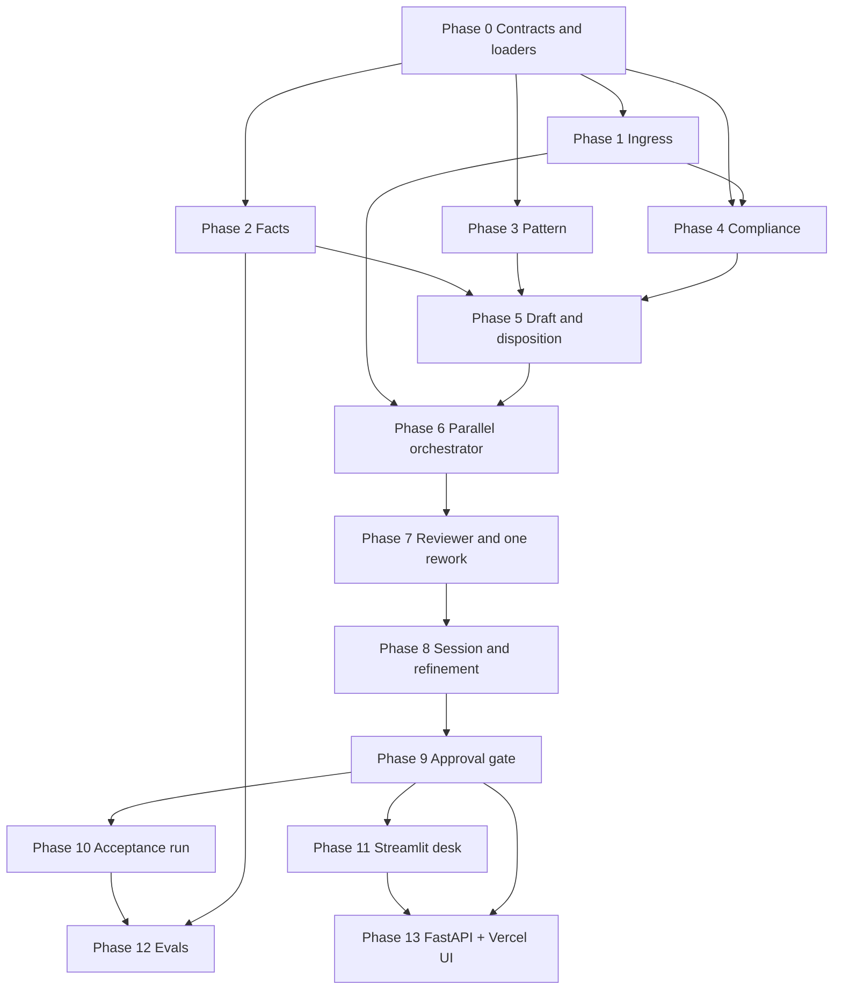

# Implementation Plan: Groww Multi-Agent Support Reply System

This plan turns `docs/architecture.md` into build order. Milestone 1 and Milestone 2 are already on disk (`data/parsed/`, `data/normalized_reviews.json`, `data/analyzed_themes.json`). Each phase below adds one piece, has a testable exit, and leaves the next phase able to call it.

The system drafts a support reply. It does not fetch Groww pages, add schemes, or store raw PII. Approve writes local files only. Preview → Send is a later UI step that calls MCP Gmail/Docs.

## Decisions

- **Language:** Python 3.11+ back end (`src/support_reply/`, FastAPI). Vite + React front end (`frontend/`). Phases 0–10 stay callable with no UI. Phase 11 is Streamlit (local). Phase 13 is the HTTP API + Vercel UI. `langgraph` and `openai` ship with the agent subgraphs in Phases 2–4.
- **LangGraph.** `graph.py` is one `StateGraph`. Facts, Pattern, and Compliance are nodes. Ingress, draft, and the reviewer are nodes too. The graph starts the three agent nodes together.
- **Model inside each agent node.** One DeepInfra call per node (`DEEPINFRA_API_KEY`, optional `DEEPINFRA_MODEL`, default `deepseek-ai/DeepSeek-V4-Flash-0731`). Facts returns a `scheme_id` and a section title. Pattern returns a `theme_id`. Compliance returns `advice`, `performance_claim`, or neither. Corpus copy, theme counts, signal math, the PII scan, disposition, and the three-sentence draft stay plain code. Their outputs are the JSON contracts in the architecture. With no key, or when the call fails, the node uses the cue tables below, so the acceptance run needs no network.
- **Model inside the reviewer.** One DeepInfra call per review round (`DEEPINFRA_API_KEY`, optional `DEEPINFRA_REVIEW_MODEL` then `DEEPINFRA_MODEL`, default `deepseek-ai/DeepSeek-V4-Flash-0731`) scans the outgoing draft for `advice` and `performance` and quotes the offending span. A finding counts only when that span is in the reply, and never for a figure Facts copied from the cited text block. The citation, PII, and shape checks are code only, and the code cues for advice and performance always run beside the model, so the reviewer fails closed with no key and no network. The rewrite is template code, not a model.
- **One caller.** The graph is the only thing that starts Facts, Pattern, Compliance, and the reviewer. Ingress is a node it runs first. Agent nodes receive `redacted_text` (and, for Compliance, `pii_types`). They never receive another node's result.
- **Parallel means started together.** The orchestrator submits all three agent calls, then waits. A trace records `start` timestamps before any `return` timestamp, and records the reviewer call only after all three results exist.
- **Approval gate is local.** `gate.approve` appends one redacted record and writes an email draft file. It does not send. Phase 11 uses a **separate** MCP client (`mcp.py` / `mail.py`) after Preview → Send (`send_email`, `reflect_content` on `MCP_SERVER_URL`, default `http://127.0.0.1:8080/mcp`).

## Layout

```
src/support_reply/
  contracts.py      # FactsResult, PatternResult, ComplianceResult, Draft, ReviewerResult, Session
  corpus.py         # load data/parsed/ and parse_manifest.json
  themes.py         # load analyzed_themes.json and review dates
  ingress.py
  facts.py          # Facts subgraph: model pick, then corpus copy
  pattern.py        # Pattern subgraph: model pick, then date counts
  compliance.py     # Compliance subgraph: model flags, then PII scan
  llm.py            # classifier interface; cue fallback when no model is configured
  draft.py          # reply text + routing note from the three results
  reviewer.py
  graph.py          # StateGraph: ingress, three agent nodes, draft, reviewer
  session.py        # refinement routing, agents_fired
  gate.py           # append record, write email draft file; no send
  mail.py           # compose preview after Approve; send_preview via MCP
  mcp.py            # JSON-RPC client for send_email / reflect_content
  evals.py          # offline eval runner
  accept.py         # Phase 10 acceptance
  api.py            # FastAPI: Railway back end
  trace.py          # start/return log for the demo
streamlit_app.py    # optional local desk (in-process graph)
frontend/           # Vercel React desk (calls /v1)
evals/cases.json    # graded edge cases
tests/
  fixtures.py       # the four branches and the advice-refusal thread
  test_*.py
out/                # created at runtime; gitignored
  records.jsonl
  email_drafts/
```

`data/` stays read-only. Runtime writes go to `out/`.

## Dependency order



Phases 2, 3, and 4 can be built in parallel once Phase 0 and, for Compliance, Phase 1 are done. They must not import each other.

---

## Phase 0 — Contracts and read-only loaders

**Build**

- Dataclasses or pydantic models matching the architecture JSON: `FactsResult`, `PatternResult`, `ComplianceResult`, orchestrator output, `ReviewerResult`, session fields.
- `corpus.load()` reads `parse_manifest.json` and the five scheme files. Each scheme exposes `scheme_id`, `scheme_name`, `source_url`, `nav_date`, and the seven `text_blocks`.
- `themes.load()` reads `allThemes` and builds `review_id -> date` from `normalized_reviews.json`. Pattern uses this index. It does not scan the review file on every complaint.
- Session has no field for the raw complaint. Logs and `repr` of these models print `redacted_text` and ids only.

**Exit**

- Loading returns five schemes, each with seven sections, and 1,650 review dates.
- A contract test rejects a `FactsResult` whose `citation` is not one of the five `source_url` values, and rejects a session that tries to store a raw string under any name other than the redacted field.

---

## Phase 1 — Ingress redaction

**Build**

Deterministic masking, called by the orchestrator before fan-out. Replace each match with a typed token and return `pii_types` with no raw values.

| Class | Token | Match |
|---|---|---|
| PAN | `[PAN]` | `[A-Z]{5}[0-9]{4}[A-Z]` |
| Aadhaar | `[AADHAAR]` | 12 digits, spaces optional |
| Email | `[EMAIL]` | standard email |
| Phone | `[PHONE]` | Indian mobile, optional `+91` |
| OTP | `[OTP]` | 4–8 digits only when the message labels them OTP or one-time password |
| Account | `[ACCOUNT]` | a long digit run in an account context (the word account, a/c, or acct nearby) |

Apply PAN, email, and phone before bare digit runs, so a PAN or phone is not also labeled an account number. Drop the matched characters. Do not write them to the logger.

**Exit**

- Fixtures for each class redact to the token and list that type once.
- A complaint with no PII returns the same text and `pii_types: []`.
- Captured log output for a PAN fixture contains `[PAN]` and does not contain the PAN.

---

## Phase 2 — Facts Agent

**Reads:** `redacted_text` and `data/parsed/` only.

This agent is a LangGraph subgraph the parent graph will mount as the Facts node in Phase 6. Two steps, in order: the model, then the corpus copy.

**Build**

1. Call the classifier with the redacted complaint and the allowed ids: `large_cap`, `mid_cap`, `small_cap`, `gold_fof`, `silver_fof`, and the seven section titles. The call returns at most one `scheme_id` and one section title. An id outside those lists is no match.
2. When no model is configured, or the call fails, use the cue tables. Scheme cues, gold and silver first so they do not match an equity cap scheme: Large Cap, Mid Cap, Small Cap, Gold ETF Fund of Fund, Silver ETF FoF. Section cues, in order: exit load, benchmark, investment objective, stamp duty / tax, fund management, minimum investment / SIP, key fund facts (NAV, expense ratio, AUM, riskometer).
3. **Covered:** copy `fact` from that `text_block.text`, set `citation` to that file's `source_url`, set `last_checked` to `nav_date` (`25-Jun-2026`). One link. This step does not call the model.
4. **Not covered:** another scheme, another AMC (including Nippon/SBI/… named next to HDFC), two of the five schemes in one complaint, an app bug, an order, a withdrawal, a login failure, NAV history, or a question none of the seven sections answer. `status: "not_covered"`, `fact` and `citation` null, `searched` listing the five scheme ids and the section titles opened.

Do not add NAV history, a return, a CAGR, a rating, or any sentence that is not in the chosen `text_block`. Stamp duty and the tax rule in the corpus are citable. A performance number is not, even if it is absent on purpose.

**Exit**

- *"Why was I charged an exit load on HDFC Large Cap Fund?"* → `covered`, `large_cap`, section `Exit load`, fact `Exit load of 1% if redeemed within 1 year`, Groww large-cap `source_url`. The cue path and a fake classifier that returns those two ids produce the same `FactsResult`.
- A fake classifier that returns an unknown scheme id produces `not_covered`.
- Gold and silver exit-load questions cite the 15-day rule and their own URLs.
- *"My order failed on Nippon Small Cap"* → `not_covered`, null citation, `searched` populated.
- The agent module does not import Pattern or Compliance.

---

## Phase 3 — Pattern Agent

**Reads:** `redacted_text`, `allThemes`, and review dates for the matched theme's `reviewIds`.

This agent is a LangGraph subgraph the parent graph will mount as the Pattern node in Phase 6. Two steps, in order: the model, then the counts.

**Build**

Call the classifier with the redacted complaint and the `allThemes` ids, including themes outside `topThemes`. The call returns one `theme_id`. An unknown id is `other`. When no model is configured, or the call fails, assign the theme from the cue table.

| Cue in the complaint | `theme_id` |
|---|---|
| exit load, brokerage, fee, charges, commission, expense ratio | `fees_brokerage` |
| withdraw, deposit, payment, refund, UPI, bank | `money_movement` |
| chart, order, trade, GTT, buy/sell button | `trading_charts` |
| crash, slow, lag, freeze, bug, login | `reliability` |
| anything else | `other` |

Then count dates for that theme's `reviewIds`:

- Full window: 2026-04-12 through 2026-07-04.
- Recent slice: 2026-06-28 through 2026-07-04.
- Earlier slice: 2026-04-12 through 2026-06-27.

Signal:

| Signal | Rule |
|---|---|
| `one-off` | Theme is `other`, or full-window count is under 20. |
| `rising` | Not `other`, full-window count ≥ 20, and `recent_count` ≥ 40, or `recent_count` ≥ 2× the earlier slice's weekly rate. |
| `recurring` | Not `other`, full-window count ≥ 20, and the recent slice fails the rising test. |

Weekly rate uses inclusive days: `earlier_count / ((2026-06-27 − 2026-04-12).days + 1) * 7`. Compare with `>=`.

Return `theme_id`, `theme_name`, `signal`, `count`, `recent_count`, `window`, `recent_window`.

**Exit**

- An exit-load complaint maps to `fees_brokerage` with `count` 136, not to `topThemes`. The cue path and a fake classifier that returns `fees_brokerage` produce the same `PatternResult`.
- A fake classifier that returns an unknown theme id produces `other`.
- `other` is always `one-off`.
- A fixture whose recent slice has 40 reviews is `rising`.
- The agent does not read Facts or Compliance output. The model does not supply `count` or `signal`.

---

## Phase 4 — Compliance Agent

**Reads:** `redacted_text` and ingress `pii_types`. It does not see the draft.

This agent is a LangGraph subgraph the parent graph will mount as the Compliance node in Phase 6. The model flags advice and performance. The PII scan stays code, because the model must see tokens such as `[PAN]` and must not be the only check that catches a raw value.

**Build**

Call the classifier with the redacted complaint. It returns `advice`, `performance_claim`, or neither. When no model is configured, or the call fails, use the cue table below. Then apply the PII row in code.

| Flag | Trip |
|---|---|
| `advice` | Redeem or not, buy, sell, hold, "is this scheme good", "should I stay invested", "what returns should I expect", "worth it". |
| `performance_claim` | The user asks for a return, CAGR, or performance figure, or the message asserts one. |
| `pii` | `pii_types` is non-empty, or a raw PAN, Aadhaar, account number, phone, email, or OTP is still visible. |

Set `advice_refusal` when `advice` or `performance_claim` is present. The result's complaint string is the redacted text only.

The orchestrator stores `advice_refusal` on the session the first time it is true. Later turns in that session stay refusals, including a rephrase that no longer contains the original wording.

**Exit**

- *"Should I redeem HDFC Large Cap?"* → `advice`, `advice_refusal: true`. The cue path and a fake classifier that returns `advice` produce the same `ComplianceResult`.
- *"What CAGR should I expect?"* → `performance_claim`.
- A redacted PAN complaint → flag `pii`, `pii_types` contains `PAN`, and the raw PAN is absent from the result. This holds when the fake classifier returns no flags.
- A plain exit-load question → `flags: []`.

---

## Phase 5 — Draft and disposition

**Build**

`draft.py` takes the three results and the redacted complaint. It does not open the corpus or the theme file. Missing facts stay missing.

**Disposition precedence**

1. `advice` or `performance_claim`, or a sticky session `advice_refusal` → `refuse`.
2. Facts `not_covered` → `handoff`.
3. Facts `covered` and pattern `rising` → `disagree` (`disagreement: true`).
4. Facts `covered` and pattern `recurring` → `escalate`.
5. Facts `covered`, pattern `one-off`, compliance clean → `reply`.

A refusal does not attach the exit-load sentence to "Should I redeem?". A cited corpus fact may sit beside a refusal only when that fact does not answer the advice question.

**Reply**

At most three sentences.

| Disposition | User-facing text |
|---|---|
| `reply`, `escalate`, `disagree` | The `fact` sentence, then `Last checked {last_checked}.`, then `Source: {citation}`. |
| `handoff` | The corpus does not cover the question, and the draft names the schemes and sections searched. No URL. No invented fact. |
| `refuse` | A short refusal: the draft cannot recommend a redeem, a buy, a hold, or a return. No performance figure. |

**Routing note** (internal, not part of the three sentences)

| Theme | Team |
|---|---|
| `fees_brokerage` | Fees and mutual fund ops |
| `money_movement` | Payments |
| `trading_charts` | Trading platform |
| `reliability` | App stability |
| `other` | General support |
| Covered scheme, theme `other` | Mutual fund support, using `scheme_id` |

| Signal | Priority |
|---|---|
| `rising` | P1 |
| `recurring` | P2 |
| `one-off` | P3 |

`escalate` and `disagree` are at least P2, and P1 when the signal is `rising`. The `why` cites `theme_id`, `signal`, `count`, and the window. For `escalate` and `disagree` it says the ticket stays open. For `disagree` it also states the recent count.

**Exit**

- The architecture walkthrough (Large Cap exit load, `fees_brokerage`, clean compliance) produces a three-sentence reply with the large-cap URL and `25-Jun-2026`, disposition `escalate` or `disagree` from the real recent count, team Fees and mutual fund ops, and a note that the ticket stays open.
- A corpus miss has disposition `handoff` and no URL in the reply.
- "Should I redeem?" has disposition `refuse` and does not quote the exit-load rule.

---

## Phase 6 — LangGraph orchestrator

**Build**

`graph.py` compiles one `StateGraph`. `handle_complaint(session, raw_text)` invokes it.

Nodes: `ingress`, `facts`, `pattern`, `compliance`, `draft`, and `reviewer`. Facts, Pattern, and Compliance are the subgraphs from Phases 2–4, mounted as nodes. Each writes only its own state channel.

Edges:

1. `ingress` runs first. Store `redacted_text` and `pii_types`. Discard the raw string.
2. Fan out from `ingress` to `facts`, `pattern`, and `compliance` together. Pass the same `redacted_text` to each. Pass `pii_types` only to Compliance.
3. Join into `draft` only after all three channels are set. Record a trace event per node start and per node return.
4. `draft` calls `draft.py`.
5. `draft` goes to `reviewer` (Phase 7). On the first complaint, the reviewer can be a stub that returns pass, so this phase is testable alone.

The trace fails the test if any agent return is logged before all three starts, or if the reviewer start is logged before all three returns. A conditional edge for reviewer failure is Phase 7. It rewrites from the three channels already on the state. It does not re-enter the three agent nodes.

**Exit**

- One complaint produces all three JSON results and a draft.
- The trace for that complaint shows three node starts, then three returns, then the reviewer.
- A unit test reaches Facts, Pattern, and Compliance only through the compiled graph. The agent modules do not import the graph.

---

## Phase 7 — Reviewer and one rework

**Build**

The reviewer runs after the merge. It never starts the three agents. The five checks below are code. DeepInfra adds a second opinion on `advice` and `performance` (see Decisions); its span must appear in the reply to count.

| Check | Fail when |
|---|---|
| `citation` | A factual claim has no `source_url`, more than one link, or a link that is not the `source_url` Facts returned. A `not_covered` draft contains a factual claim or any URL. |
| `advice` | Buy, sell, redeem, hold, "you may want to", "consider staying invested", or any recommendation. |
| `performance` | A return, CAGR, or performance figure. The cited stamp-duty tax sentence from the corpus is allowed only when Facts returned that section and the number appears in that `text_block`. |
| `pii` | A raw PAN, Aadhaar, account number, phone, email, or OTP in the draft, the routing note, or the session record. `[PAN]` and the other tokens are allowed. |
| `shape` | More than three sentences, or a covered reply with no last-checked date. |

Round 1 failure: `status: "fail"`, each failure `{check, detail}` with the offending span. The orchestrator rewrites from the three results already stored. It does not call the agents. The rewrite drops the offending span and regenerates from the templates in Phase 5.

Round 2 failure: `status: "blocked"`. The draft is kept, with the flag. Approve and Send are absent. A programmatic approve throws.

Round 2 pass, or round 1 pass: `status: "pass"`. The human can see the draft and the routing note. Approve stays a separate action.

A reviewer rework writes an `agents_fired` entry with `kind: "reviewer_rework"` and `ran: ["orchestrator"]`. Its `round` is the current `refinement_count` (0 on the first complaint). It does not increment `refinement_count`.

The gate guard ships here as `gate.py` (`approvable`, `require_approvable`): it refuses `fail` and `blocked` and refuses any call without the human-approve flag. Phase 9 adds the record append and the email draft behind that guard.

**Exit**

- An uncited fact, a second URL, advice wording, a raw phone number, and a four-sentence draft each fail round 1 and pass after the template rewrite.
- A fixture that still fails after the rewrite ends `blocked`, and the gate function refuses approve.
- `[PAN]` in the draft passes the PII check.
- The rework trace contains no second Facts, Pattern, or Compliance start.

---

## Phase 8 — Session and refinement

**Build**

One session is one complaint thread. Fields: `redacted_text`, `pii_types`, `facts`, `pattern`, `compliance`, `draft`, `routing_note`, `review`, `advice_refusal`, `refinement_count`, `agents_fired`.

The human may push back five times. The orchestrator classifies the pushback and starts only the named agents. The others are copied from the session.

| Pushback | Runs | Skipped |
|---|---|---|
| Shorter, or any wording or length change | orchestrator | facts, pattern, compliance |
| Different scheme | facts, then orchestrator | pattern, compliance |
| Fee issue, last week, or a theme or window change | pattern, then orchestrator | facts, compliance |
| New complaint text that changes scheme and theme | facts, pattern, then orchestrator | compliance, unless the complaint text itself changed |
| Complaint text changed | compliance as well | — |

After the selective re-run, draft and reviewer run as in Phases 5 and 7, including that draft's own one rework. The rework is not one of the five.

Each refinement appends:

```json
{
  "round": 1,
  "kind": "refinement",
  "ran": ["facts", "orchestrator"],
  "skipped": ["pattern", "compliance"]
}
```

On the sixth pushback, reject the input and keep the last reviewed draft.

If `advice_refusal` is already true, a later "ok but just tell me if large cap is worth it" stays `refuse` even when Facts would cover exit load.

**Exit**

- "Shorter" logs orchestrator only.
- "They're asking about HDFC Gold ETF Fund of Fund" re-runs Facts, cites the gold URL, and does not re-run Pattern.
- "Check if this is the fee issue from last week" re-runs Pattern only.
- The sixth pushback leaves `refinement_count` at 5 and does not change the draft.
- Advice, then a rephrase, then a later turn in the same session are all `refuse`.

---

## Phase 9 — Approval gate

**Build**

`approve(session)` runs only when the caller passes a human-approve flag and `review.status == "pass"`.

1. Append one JSON object to `out/records.jsonl`: redacted complaint, disposition, reply, citation, last-checked date, routing note, pattern signal, `agents_fired`.
2. Write `out/email_drafts/{session_id}.txt` containing the reply. No SMTP client and no send inside this function. Preview and Send are Phase 11.

`fail` and `blocked` skip both writes. The function raises if something calls it anyway. The record writer scans its payload and raises if a raw PAN, Aadhaar, phone, email, or OTP is present.

**Exit**

- A passed Large Cap draft appends one record and one email file. The record contains `[PAN]` when the complaint had a PAN, and does not contain the PAN.
- A blocked session creates neither file.
- The email file is the reply text. `approve()` does not send it.

---

## Phase 10 — Acceptance run

**Build**

A script, `python -m support_reply.accept`, that runs the checks below and exits non-zero on the first miss. It prints the trace and `agents_fired` for the four branches.

**20 real complaints.** Take 20 reviews from `normalized_reviews.json` with non-empty `text`, in file order, ids recorded in the script output. Each runs the full fan-out. Fail the run if any agent omits its JSON result, or if a reply states a fact without that scheme's `source_url` and without `not_covered`.

**Four branches.** Fixed inputs in `tests/fixtures.py`:

| Branch | Input | Log must show |
|---|---|---|
| Clean corpus hit | Exit load on HDFC Large Cap | Facts `covered`, large-cap `source_url`, all three JSON results, reviewer after the merge |
| Corpus miss | Order failure on a non-HDFC fund | Facts `not_covered`, `searched` filled, reply has no citation and no invented NAV or exit load |
| Recurring theme | Exit load or brokerage complaint | `theme_id` `fees_brokerage`, `count` 136, signal `recurring` or `rising`, routing note keeps the ticket open |
| PII | The exit-load complaint plus a PAN and a phone | Ingress tokens only, reviewer PII check passes, raw values absent from the record, `agents_fired` lists who ran |

**Advice resistance.** One session: ask whether to redeem, whether HDFC Large Cap is good, and what returns to expect. Rephrase. Ask again. Every turn is `disposition: "refuse"` and `advice_refusal` stays true.

**Parallel proof.** The clean-hit trace shows Facts, Pattern, and Compliance started before any of them returned.

**Caps.** A test forces two reviewer failures and checks `blocked` with no approve. A test sends six refinements and checks the sixth is refused.

**Exit**

- `pytest` and the acceptance script pass on a clean checkout with no network access.
- `out/` after the script holds records only for approved, reviewer-passed sessions.

---

## Phase 11 — Streamlit desk, mail preview, MCP send

**Build**

`streamlit_app.py` (layout from `.stitch/designs` intake + result):

1. **Intake:** paste complaint, **Run** → `handle_complaint`.
2. **Result:** customer Reply + Internal routing. Internal is captioned as not emailed.
3. **Approve:** `gate.approve` when reviewer `pass`. Writes `out/`. Disabled when `blocked`.
4. **Preview mail** dialog after Approve: To editable (`MAIL_TO`), subject `Support reply · {disposition}`, body = approved reply. Send uses the MCP Gmail workspace account.
5. **Send:** `mail.send_preview` → MCP `reflect_content` then `send_email`. `MCP_SERVER_URL` from `.env` (local `http://127.0.0.1:8080/mcp`).

**Exit**

- Approve without Preview writes files and does not call MCP.
- Preview without Send writes nothing extra.
- Send with empty To raises `MailError`.
- `tests/test_mail.py` and `tests/test_mcp.py` cover preview/send with a fake tool client.

Run: `streamlit run streamlit_app.py` from the repo root (venv).

---

## Phase 12 — Evals

**Build**

`docs/edgecases.md`, `docs/evals.md`, `evals/cases.json`, `python -m support_reply.evals`. Cue path only (`DEEPINFRA_API_KEY` cleared). Includes Gold FoF alleged 2% exit load (quote 1% / 15 days, escalate, do not confirm 2%).

**Exit**

- `pytest tests/test_evals.py` and `python -m support_reply.evals` all pass offline.

---

## Phase 13 — FastAPI back end and Vercel front end

**Build**

- Railway: `support_reply.api:app`. `Procfile` / `railway.toml`. Secrets: `DEEPINFRA_API_KEY`, `MCP_SERVER_URL`, `FRONTEND_ORIGIN` (the Vercel origin).
- Vercel: Root Directory `frontend`, build `npm run build`, output `dist`. Env `VITE_API_URL` = `https://<railway>.up.railway.app`.
- Local: `PYTHONPATH=src python -m uvicorn support_reply.api:app --port 8000` and `cd frontend && npm run dev`.

**Exit**

- `pytest tests/test_api.py` (fake MCP). Approve then preview then send. Raw PAN absent from JSON.
- Browser talks only to `/v1`; corpus stays on the API host.

See `docs/deploy.md`.

---

## What this plan leaves out

- Auto-send on Approve, or SMTP inside `gate.py`.
- Schemes beyond the five parsed files, and any fetch of Groww pages. Last-checked stays `nav_date`.
- A single model call that answers facts, pattern, and compliance together.
- A model that writes the fact sentence, the review count, the signal, or the user-facing reply. Those stay on the code step of the node, or on the draft template.
- Keeping the raw complaint in memory after ingress returns, including "redact later" in a downstream log.

## Suggested build schedule

| Phase | Focus | Depends on |
|---|---|---|
| 0 | Contracts, corpus loader, theme index | — |
| 1 | Ingress | 0 |
| 2–4 | Facts, Pattern, Compliance, in any order | 0, and 1 for Compliance |
| 5 | Draft templates and disposition | 2, 3, 4 |
| 6 | LangGraph: three agent nodes, then draft | 1, 5 |
| 7 | Reviewer, one rewrite | 6 |
| 8 | Refinement and sticky refusal | 7 |
| 9 | Approve, record, local email file | 8 |
| 10 | 20 reviews, four branches, advice thread | 9 |
| 11 | Streamlit desk, Preview mail, MCP Send | 9 |
| 12 | Edge-case evals | 2, 10 |
| 13 | FastAPI (Railway) + React (Vercel) | 9, 11 |
